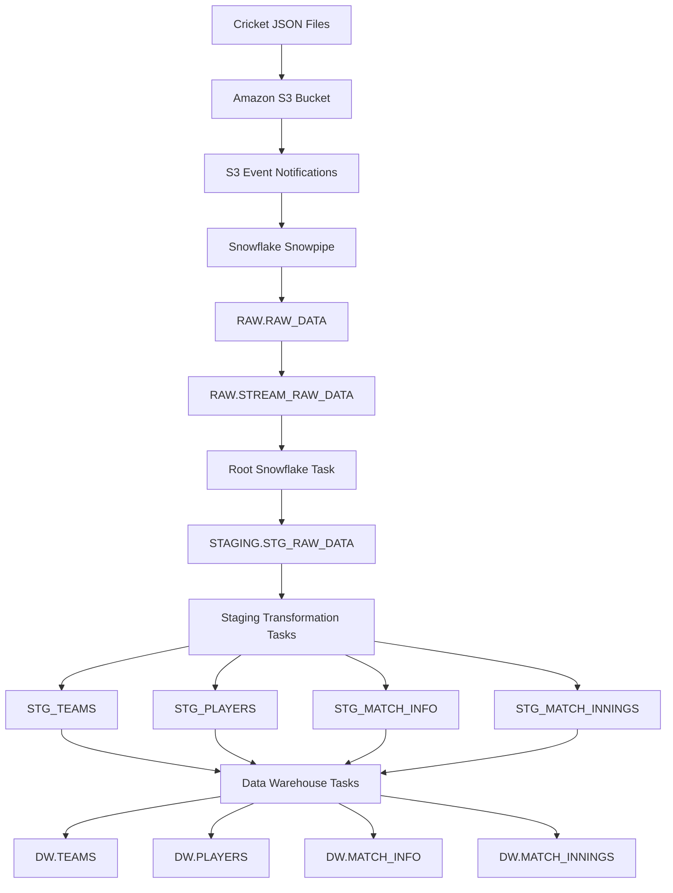
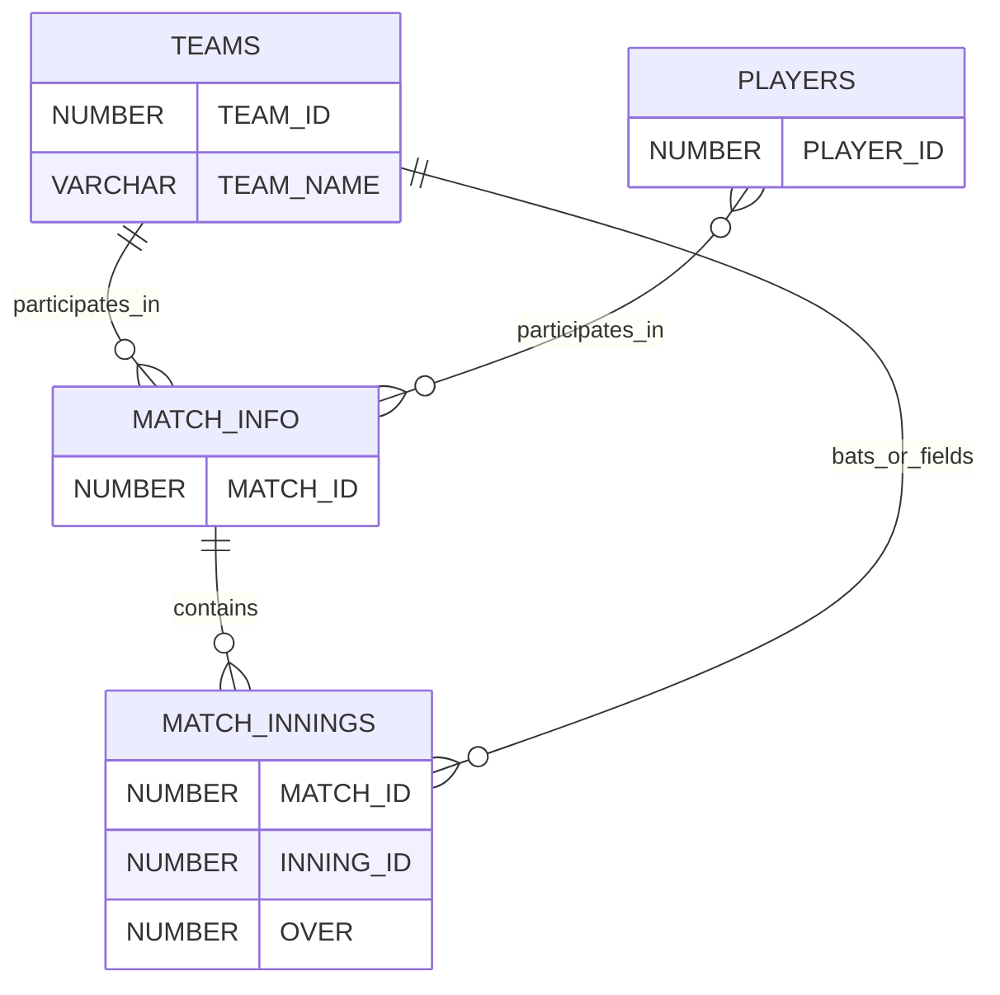

# Cricket Data Engineering Pipeline 🏏

### Automated Cricket Data Ingestion and Transformation Using AWS and Snowflake

An end-to-end data engineering project that ingests cricket data in JSON format from Amazon S3, automatically loads new files into Snowflake using Snowpipe, transforms raw data into structured staging tables, and loads curated cricket data into a data warehouse for analytics.

The pipeline uses **Amazon S3, AWS event notifications, Snowpipe, Snowflake Streams, and Snowflake Tasks** to automate data processing whenever new files arrive.

---

## 📌 Table of Contents

- [Project Overview](#-project-overview)
- [Business Problem](#-business-problem)
- [Architecture](#-architecture)
- [Technology Stack](#-technology-stack)
- [Pipeline Workflow](#-pipeline-workflow)
- [Data Warehouse Design](#-data-warehouse-design)
- [Automation Strategy](#-automation-strategy)
- [Repository Structure](#-repository-structure)
- [Prerequisites](#-prerequisites)
- [Setup and Execution](#-setup-and-execution)
- [Validation and Monitoring](#-validation-and-monitoring)
- [Data Quality and Reliability](#-data-quality-and-reliability)
- [Security Considerations](#-security-considerations)
- [Challenges and Learnings](#-challenges-and-learnings)
- [Future Enhancements](#-future-enhancements)

---

## 🎯 Project Overview

This project demonstrates an automated cloud-based data pipeline for cricket analytics.

Cricket data arrives as JSON files in an Amazon S3 bucket. AWS event notifications trigger Snowflake's Snowpipe auto-ingest mechanism, which loads the incoming data into a raw data table.

A Snowflake stream tracks changes to the raw table. A task processes those changes and transfers them into the staging layer. Additional tasks transform the JSON data into structured cricket entities and load the results into a data warehouse.

The resulting data model supports analysis of teams, players, matches, innings, and ball-by-ball information.

### Key objectives

- Automate ingestion of new cricket JSON files.
- Integrate Amazon S3 with Snowflake.
- Implement event-driven ingestion using Snowpipe.
- Track new data using Snowflake Streams.
- Orchestrate transformations using Snowflake Tasks.
- Separate raw, staging, and curated warehouse layers.
- Build a foundation for cricket reporting and analytics.
- Document a reproducible, maintainable data engineering workflow.

---

## 💼 Business Problem

Cricket match data often contains nested JSON structures representing match metadata, teams, players, innings, overs, and individual deliveries.

Working directly with raw JSON can make analysis difficult because the data is nested, inconsistent in structure, and not always suitable for relational queries.

A manual ingestion process also requires repeated intervention whenever new match files become available.

This project addresses those challenges by building an automated pipeline that:

1. Detects new files arriving in cloud storage.
2. Loads the raw data into Snowflake.
3. Extracts structured entities from JSON.
4. Organizes data into staging and warehouse tables.
5. Reduces the need for manual ingestion and transformation.
6. Provides structured tables for downstream analytical queries.

---

## 🏗️ Architecture

### High-level architecture



### Architecture components

| Component | Responsibility |
|---|---|
| Amazon S3 | Stores incoming cricket JSON files |
| S3 event notifications | Notify Snowflake when matching S3 objects are created |
| Snowflake storage integration | Provides configured access to the external S3 location |
| External stage | References the cricket data stored in S3 |
| Snowpipe | Automatically loads new files into the raw table |
| Raw table | Preserves the ingested JSON payload and source filename |
| Stream | Tracks changes made to the raw table |
| Root task | Processes stream data into the staging raw table |
| Staging tables | Hold structured cricket entities extracted from JSON |
| Snowflake Tasks | Automate transformation and warehouse loading |
| Data warehouse | Stores curated cricket data for analysis |

---

## 🔄 Pipeline Workflow

### 1. Data ingestion into Amazon S3

Cricket data is supplied as JSON files and uploaded to an S3 location:

`s3://<bucket-name>/cricket/`

The bucket and prefix must match the configured Snowflake external stage and the relevant event notification filters.

### 2. Event-driven ingestion with Snowpipe

An S3 event notification triggers the Snowpipe auto-ingest mechanism when a matching file is uploaded.

The pipe, `CRICKET_ANALYTICS.RAW.S3_PIPE`, loads the file contents and source filename into `CRICKET_ANALYTICS.RAW.RAW_DATA`.

The raw table uses:

- `RAW_FILE`: A Snowflake `VARIANT` column containing the JSON payload.
- `FILENAME`: A column recording the source filename.

This preserves the original JSON structure for downstream processing.

### 3. Change tracking with Snowflake Streams

The stream `CRICKET_ANALYTICS.RAW.STREAM_RAW_DATA` tracks changes to the raw table.

The stream allows the pipeline to process newly ingested records without requiring the root task to repeatedly reload every raw record.

### 4. Automated processing with Snowflake Tasks

The root task checks whether the stream contains data.

When new data is available, the task transfers stream records into `STAGING.STG_RAW_DATA`.

Downstream tasks process the staged JSON and extract the relevant cricket entities.

The task graph separates the ingestion step from the transformation and warehouse-loading steps.

### 5. Staging transformations

The staging layer converts nested JSON fields into relational columns.

It contains tables for:

- Teams
- Players
- Match information
- Match innings and ball-level information

This layer makes the data easier to validate, join, and load into the warehouse.

### 6. Data warehouse loading

The final layer stores curated records in the following tables:

| Table | Purpose |
|---|---|
| `DW.TEAMS` | Stores cricket team records |
| `DW.PLAYERS` | Stores player records |
| `DW.MATCH_INFO` | Stores match-level metadata |
| `DW.MATCH_INNINGS` | Stores innings and ball-level records |

Sequences generate surrogate identifiers where configured. Warehouse-loading tasks use matching and duplicate checks to help avoid inserting records that already exist.

---

## 🧰 Technology Stack

| Technology | Use |
|---|---|
| Amazon S3 | Cloud object storage |
| AWS S3 Event Notifications | Event-driven file arrival notifications |
| AWS SQS | Notification channel used by Snowpipe auto-ingest |
| Snowflake | Cloud data platform |
| Snowflake SQL | Table creation and data transformation |
| Snowpipe | Automated file ingestion |
| Snowflake Streams | Change tracking |
| Snowflake Tasks | Task scheduling and orchestration |
| JSON | Source data format |
| Git and GitHub | Version control and project documentation |

---

## 🗃️ Data Warehouse Design

The pipeline follows a layered architecture that separates ingestion, transformation, and analytical storage.

### Raw layer

**Schema:** `RAW`

Primary table:

`RAW.RAW_DATA`

The raw layer stores source JSON with minimal transformation. Keeping the original payload helps with troubleshooting and reprocessing.

### Staging layer

**Schema:** `STAGING`

Tables:

- `STAGING.STG_RAW_DATA`
- `STAGING.STG_TEAMS`
- `STAGING.STG_PLAYERS`
- `STAGING.STG_MATCH_INFO`
- `STAGING.STG_MATCH_INNINGS`

The staging layer extracts and organizes JSON attributes into relational structures.

### Data warehouse layer

**Schema:** `DW`

Tables:

- `DW.TEAMS`
- `DW.PLAYERS`
- `DW.MATCH_INFO`
- `DW.MATCH_INNINGS`

The warehouse contains the curated data used for downstream analysis.

### Conceptual relationships



---

## ⚙️ Automation Strategy

The pipeline combines event-driven ingestion with scheduled, condition-based processing.

### Snowpipe auto-ingest

Snowpipe receives file-arrival notifications through its configured AWS notification channel and loads new matching files.

### Stream-triggered processing

The root task uses a condition equivalent to:

```sql
WHEN SYSTEM$STREAM_HAS_DATA(
    'CRICKET_ANALYTICS.RAW.STREAM_RAW_DATA'
)
```

This allows the task to run when the stream has data to process rather than performing unnecessary processing on every scheduled check.

### Task orchestration

The downstream tasks are organized using task dependencies.

The intended processing sequence is:

1. Raw stream processing.
2. Staging transformations.
3. Team warehouse loading.
4. Player warehouse loading.
5. Match metadata loading.
6. Innings and ball-level loading.

The actual dependency graph is defined by the SQL task DDL.

### Incremental processing considerations

The root task appends incoming stream records to `STAGING.STG_RAW_DATA`. It does not truncate that table on each run.

This preserves accumulated staging raw data. The downstream transformations and warehouse loads must therefore be designed with the expected data volume, duplicate handling, and reprocessing requirements in mind.

---

## 📁 Repository Structure

```text
cricket-data-engineering-pipeline/
│
├── README.md
├── LICENSE
├── .gitignore
│
├── docs/
│   ├── architecture.md
│   ├── aws-setup.md
│   └── data-model.md
│
├── data/
│   └── samples/
│       └── README.md
│
├── sql/
│   ├── 01_database_and_schemas.sql
│   ├── 02_raw_layer.sql
│   ├── 03_staging_layer.sql
│   ├── 04_data_warehouse.sql
│   ├── 05_streams_and_tasks.sql
│   ├── 06_initial_load.sql
│   └── 07_validation_queries.sql
│
├── images/
│   ├── architecture.png
│   └── pipeline_results.png
│
└── requirements.txt
```

The repository separates infrastructure setup, raw ingestion, transformations, warehouse loading, initial data loading, and validation.

Files should be executed in the documented order. Some setup steps also require AWS console configuration and appropriate Snowflake permissions.

---

## 🚀 Prerequisites

Before deploying the pipeline, you need:

- An AWS account with access to Amazon S3.
- An S3 bucket containing cricket JSON files.
- Permission to configure S3 event notifications.
- A Snowflake account.
- A Snowflake role with the required database, schema, table, stage, pipe, stream, task, and integration privileges.
- A configured Snowflake storage integration for the S3 location.
- A configured external stage.
- A working Snowpipe auto-ingest configuration.
- A Snowflake warehouse for task execution.

The exact permissions depend on how your AWS and Snowflake environments are configured.

---

## 🛠️ Setup and Execution

### Step 1: Clone the repository

```bash
git clone <your-github-repository-url>
cd cricket-data-engineering-pipeline
```

Replace the placeholder with your repository URL.

### Step 2: Review the configuration

Before running the SQL, review:

- Database and schema names.
- Warehouse name.
- S3 bucket and prefix.
- Storage integration settings.
- External stage definition.
- Snowpipe configuration.
- Task dependencies.
- Table definitions and sequences.

Do not commit credentials or account-specific secrets.

### Step 3: Create the database and schemas

Execute:

`sql/01_database_and_schemas.sql`

This establishes the Snowflake environment used by the pipeline.

### Step 4: Configure the raw ingestion layer

Execute or verify:

`sql/02_raw_layer.sql`

Configure the storage integration, external stage, and Snowpipe according to your AWS and Snowflake environment.

Ensure that S3 event notifications point to the correct Snowflake-generated SQS notification channel and cover the intended object prefix.

### Step 5: Create staging tables

Execute:

`sql/03_staging_layer.sql`

This creates the tables used to extract structured entities from the raw JSON data.

### Step 6: Create warehouse tables and sequences

Execute:

`sql/04_data_warehouse.sql`

This establishes the curated data model and identifier sequences.

### Step 7: Create streams and tasks

Execute:

`sql/05_streams_and_tasks.sql`

Verify that the stream references the correct raw table and that task dependencies point to the intended predecessor tasks.

### Step 8: Perform the initial load, if needed

Execute:

`sql/06_initial_load.sql`

Run the initial load or historical backfill only when required by your deployment process.

Avoid running destructive reset commands against an environment containing data you need to preserve.

### Step 9: Enable automation

Verify the task graph, resume the root task, and ensure that dependent tasks are resumed as required by your implementation.

Confirm that Snowpipe auto-ingest is running.

### Step 10: Validate the pipeline

Execute:

`sql/07_validation_queries.sql`

Check the raw, staging, and warehouse tables to confirm that records have been processed successfully.

---

## 🔍 Validation and Monitoring

The pipeline can be monitored using Snowflake SQL.

### Check Snowpipe status

```sql
SELECT PARSE_JSON(
    SYSTEM$PIPE_STATUS(
        'CRICKET_ANALYTICS.RAW.S3_PIPE'
    )
) AS PIPE_STATUS;
```

This returns information about the pipe's execution state, notification channel, and pending work.

### Inspect raw data

```sql
SELECT
    FILENAME,
    RAW_FILE
FROM CRICKET_ANALYTICS.RAW.RAW_DATA
LIMIT 10;
```

### Check warehouse record counts

```sql
SELECT COUNT(*) AS TEAM_COUNT
FROM CRICKET_ANALYTICS.DW.TEAMS;

SELECT COUNT(*) AS PLAYER_COUNT
FROM CRICKET_ANALYTICS.DW.PLAYERS;

SELECT COUNT(*) AS MATCH_COUNT
FROM CRICKET_ANALYTICS.DW.MATCH_INFO;

SELECT COUNT(*) AS INNINGS_RECORD_COUNT
FROM CRICKET_ANALYTICS.DW.MATCH_INNINGS;
```

### Check task execution history

```sql
SELECT
    NAME,
    STATE,
    SCHEDULED_TIME,
    QUERY_START_TIME,
    COMPLETED_TIME,
    ERROR_CODE,
    ERROR_MESSAGE
FROM TABLE(
    CRICKET_ANALYTICS.INFORMATION_SCHEMA.TASK_HISTORY(
        SCHEDULED_TIME_RANGE_START =>
            DATEADD('HOUR', -24, CURRENT_TIMESTAMP()),
        RESULT_LIMIT => 100
    )
)
ORDER BY SCHEDULED_TIME DESC;
```

Task history helps identify failed executions, scheduling issues, and errors in transformations.

---

## 🧪 Data Quality and Reliability

A production-ready pipeline should validate data at each stage.

Potential checks include:

- Required fields are present in incoming JSON.
- Source filenames are recorded correctly.
- Match identifiers are valid.
- Team and player references can be resolved.
- Duplicate records are detected.
- Numeric fields use the expected types.
- Null values are handled consistently.
- Warehouse records are not duplicated during retries.
- Failed files can be identified and reprocessed.

The current implementation uses matching and duplicate checks in warehouse-loading logic. These checks should be tested against the actual source data, especially when files are re-uploaded or historical data is reprocessed.

Snowpipe file-load deduplication and application-level record deduplication solve different problems. Both should be considered when designing recovery and replay procedures.

---

## 🔐 Security Considerations

This repository should contain SQL definitions and documentation, not credentials.

Security practices include:

- Using a Snowflake storage integration rather than embedding AWS access keys in SQL.
- Granting only the AWS permissions needed for the configured S3 location.
- Restricting access to Snowflake objects through roles and grants.
- Keeping account-specific secrets out of Git.
- Using placeholders for environment-specific values in public examples.
- Reviewing sample data before publishing it.
- Avoiding unnecessary exposure of account identifiers and infrastructure details.

Never commit passwords, private keys, AWS secret access keys, or authentication tokens.

---

## 🧠 Challenges and Learnings

This project demonstrates several practical data engineering concepts.

### Event-driven ingestion

Configured S3 notifications and Snowpipe auto-ingest to load new files without manually issuing a `COPY INTO` command for each arrival.

### Change data processing

Used a Snowflake stream to track changes to the raw table and trigger downstream processing.

### Task orchestration

Defined a task graph to separate raw ingestion, staging transformations, and warehouse loading.

### Layered data architecture

Separated raw JSON, structured staging records, and curated warehouse tables to improve maintainability.

### Incremental processing and recovery

Considered how streams, task retries, table resets, duplicate files, and historical backfills affect pipeline correctness.

### Troubleshooting

Validated Snowpipe status and task execution history to distinguish ingestion issues from transformation and orchestration failures.

---

## 🚧 Future Enhancements

Potential improvements include:

- Build interactive cricket dashboards using Power BI, Tableau, or Streamlit.
- Add analytical SQL queries for team performance, player statistics, and match outcomes.
- Introduce automated data-quality checks.
- Add logging and failure notifications.
- Implement a formal recovery and replay strategy.
- Add deployment scripts and environment-specific configuration.
- Introduce automated SQL testing.
- Add CI/CD for controlled deployment of Snowflake objects.
- Evaluate cost, query performance, and task scheduling as data volumes increase.

---

---
